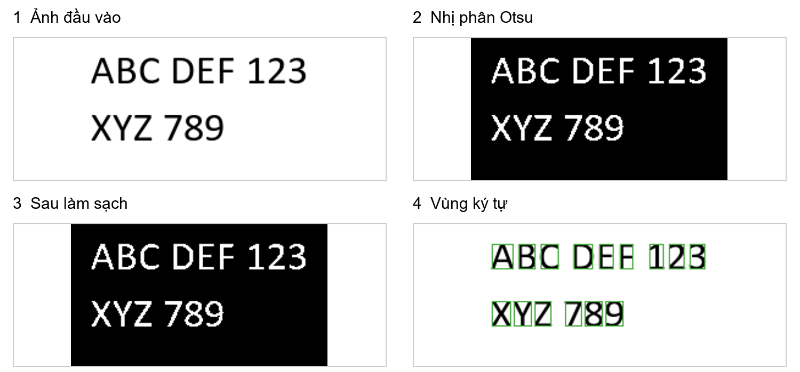

# Nhận dạng chữ in tiếng Anh bằng xử lý ảnh số và so khớp mẫu

BÁO CÁO CUỐI KỲ MÔN XỬ LÝ ẢNH SỐ

Đề tài thực nghiệm trên dự án Classical OCR Lab

## Tóm tắt

Nhận dạng ký tự quang học là quá trình chuyển nội dung chữ trong ảnh thành chuỗi văn bản có thể chỉnh sửa. Báo cáo trình bày việc xây dựng một hệ thống nhận dạng chữ in tiếng Anh bằng các phương pháp xử lý ảnh cổ điển và so khớp mẫu. Mục tiêu của đề tài là làm rõ quan hệ giữa biểu diễn ảnh, tiền xử lý, phân đoạn và quyết định nhận dạng thông qua một chương trình có mã nguồn và dữ liệu kiểm chứng. Hệ thống sử dụng Python, OpenCV, NumPy và Pillow; giao diện được xây dựng bằng HTML, CSS và JavaScript, kết nối với máy chủ Python chạy cục bộ.

Quy trình nhận dạng gồm chuyển ảnh sang mức xám, xử lý gạch đỏ khi thỏa điều kiện hình học và màu sắc, nhị phân hóa bằng Otsu, làm sạch thành phần liên thông, phân đoạn dòng và ký tự bằng hình chiếu, chuẩn hóa ký tự về khung 48 × 48 pixel, so sánh với ngân hàng mẫu và tái tạo văn bản. Pixel Similarity là độ đo của luồng nhận dạng chính; tương quan chéo chuẩn hóa được cài đặt để hỗ trợ thực nghiệm. Một số quy tắc hình học được bổ sung nhằm giữ chấm của chữ i và j, nhận biết dấu câu và xử lý có điều kiện những vùng có khả năng chứa ký tự dính nhau.

Trên kết quả đã lưu của bộ 32 ảnh tổng hợp, hệ thống có 34 lỗi chỉnh sửa trên 688 ký tự tham chiếu, tương ứng tỷ lệ lỗi ký tự 4,94% và 15 ảnh đúng hoàn toàn. Với bộ 100 đoạn văn tổng hợp, số lỗi là 2.741 trên 78.224 ký tự, tương ứng tỷ lệ lỗi 3,50% và 50 ảnh đúng hoàn toàn. Những số liệu này được kiểm tra lại từ chuỗi tham chiếu và chuỗi dự đoán, không phải một lượt chạy mới toàn bộ OCR. Vì ảnh đánh giá và ngân hàng mẫu sử dụng cùng các font Calibri, Verdana, Arial và Times New Roman, kết quả phản ánh điều kiện font đã có mẫu. Báo cáo phân tích giới hạn đó cùng các vấn đề về ký tự dính, khác biệt font, ánh sáng và tái tạo khoảng trắng.

Từ khóa: xử lý ảnh số; OCR; Otsu; phân đoạn ký tự; so khớp mẫu; Pixel Similarity; CER.

## 1 Giới thiệu

### 1.1 Bối cảnh và động cơ thực hiện

Một ảnh chứa văn bản chỉ lưu thông tin dưới dạng các điểm ảnh. Người dùng có thể đọc chữ trên ảnh nhưng máy tính chưa có sẵn chuỗi ký tự tương ứng để tìm kiếm, thống kê hay chỉnh sửa. Chẳng hạn, một ảnh chụp đoạn tài liệu có thể hiển thị rõ câu “Classical OCR 2026”, nhưng thao tác tìm kiếm bằng từ khóa sẽ không hoạt động nếu ảnh chưa được chuyển thành văn bản. OCR, viết tắt của Optical Character Recognition, giải quyết bước chuyển đổi này bằng cách liên hệ hình dạng vùng ảnh với ký hiệu trong một tập ký tự.

Trong phạm vi môn học, OCR là bài toán phù hợp để quan sát vai trò của nhiều công đoạn xử lý ảnh. Màu sắc ảnh đầu vào ảnh hưởng đến ảnh mức xám; ngưỡng nhị phân ảnh hưởng đến độ liền nét; lọc nhiễu có thể làm mất dấu chấm; một đường cắt phân đoạn sai có thể biến hai ký tự thành một vùng ảnh. Vì vậy, sai số đầu ra cần được giải thích từ toàn bộ chuỗi xử lý thay vì chỉ xem xét công thức phân loại cuối cùng.

Đề tài lựa chọn so khớp mẫu nhằm giữ cho quá trình nhận dạng có thể phân tích trực tiếp. Mỗi quyết định bắt đầu từ một vùng ảnh ký tự, được chuẩn hóa và so sánh với những ảnh mẫu biết trước nhãn. Cách tiếp cận này không cần huấn luyện mạng nơ-ron, đồng thời cho phép kiểm tra ảnh nhị phân, hộp bao, mẫu tương ứng và điểm giống nhau. Giá trị của đề tài nằm ở việc hiện thực hóa, đo lường và giải thích một hệ thống cổ điển trong điều kiện có kiểm soát.

### 1.2 Mục tiêu và phạm vi

Mục tiêu thứ nhất là xây dựng luồng xử lý hoàn chỉnh từ ảnh PNG hoặc JPEG đến văn bản nhiều dòng. Mục tiêu thứ hai là cài đặt trực tiếp phép so khớp bằng NumPy, qua đó làm rõ cách một độ đo giữa hai ma trận nhị phân dẫn đến quyết định ký tự. Mục tiêu thứ ba là đánh giá bằng dữ liệu có văn bản tham chiếu, báo cáo số lỗi chỉnh sửa và phân tích những nhóm lỗi còn tồn tại. Mục tiêu cuối cùng là cung cấp giao diện cục bộ để người dùng tải ảnh, đọc kết quả và kiểm tra vị trí các vùng được nhận dạng.

Đầu vào mục tiêu là chữ in tiếng Anh gồm A–Z, a–z, 0–9 và các dấu câu trong tập mẫu, trên nền tương đối đồng đều và có hướng dòng gần ngang. Hệ thống chưa hỗ trợ chữ viết tay, tiếng Việt có dấu, bố cục nhiều cột phức tạp hay chỉnh phối cảnh tài liệu. Thuật toán có thể đảo cực tính nhị phân khi tỷ lệ tiền cảnh lớn hơn một nửa ảnh, nhưng quy tắc này không đủ để bảo đảm nhận dạng mọi trường hợp chữ sáng trên nền tối.

Đề tài sử dụng các phép xử lý ảnh và so khớp mẫu, không tích hợp thư viện OCR dựng sẵn, mô hình học sâu hay dịch vụ nhận dạng qua API bên ngoài. OpenCV đảm nhiệm các thao tác ảnh cơ bản; NumPy thực hiện tính điểm; Pillow tạo ảnh chữ từ font. Những thư viện này cung cấp công cụ tính toán, còn việc nối các bước thành hệ thống OCR và xử lý các tình huống hình học được thể hiện trong mã của dự án.

### 1.3 Cơ sở tham khảo và đóng góp của bản triển khai

Bài báo của Hossain và Afrin là tài liệu định hướng cho phương pháp so khớp mẫu [1]. Bài báo trình bày các giai đoạn tiền xử lý, trích xuất đặc trưng, chuẩn bị mẫu và so sánh, sử dụng hai font Calibri và Verdana trong dữ liệu mẫu. Tuy nhiên, bài báo không đặc tả đầy đủ công thức độ tương tự hoặc cách phân đoạn văn bản nhiều dòng. Do đó, báo cáo xem đây là triển khai dựa trên ý tưởng của tài liệu tham khảo; không tuyên bố tái lập chính xác thí nghiệm gốc.

Các lựa chọn như Otsu, hình chiếu dòng và cột, khung chuẩn hóa 48 × 48, Pixel Similarity, quy tắc giữ dấu câu và giao diện web là những quyết định cụ thể của dự án. Việc mở rộng ngân hàng mẫu sang Arial và Times New Roman cũng làm thay đổi điều kiện thực nghiệm so với bài báo. Phân biệt này giúp người đọc nhận biết phần nào là cơ sở học thuật và phần nào cần được đánh giá bằng kết quả của chính chương trình.

## 2 Cơ sở xử lý ảnh số

### 2.1 Biểu diễn ảnh số

Ảnh mức xám có thể biểu diễn bằng ma trận I có H hàng và W cột. Mỗi phần tử I(y, x) lưu cường độ tại tọa độ tương ứng. Với ảnh 8 bit, giá trị thường nằm trong khoảng từ 0 đến 255. Ảnh màu ba kênh có thêm chiều kênh màu, nên được lưu dưới dạng H × W × 3. Trong dự án, OpenCV nạp ảnh theo thứ tự BGR; do đó mọi phép chuyển màu phải sử dụng đúng thứ tự này.

Hai khái niệm quan trọng là độ phân giải không gian và độ phân giải mức cường độ. Độ phân giải không gian quyết định số mẫu dùng để mô tả hình dạng chữ. Một nét cong có thể rõ ở ảnh lớn nhưng bị rút xuống chỉ còn vài pixel ở ảnh nhỏ. Độ phân giải mức cường độ quyết định số mức sáng được giữ lại. Khi nhị phân hóa, thông tin mức xám bị rút xuống hai trạng thái, nên lựa chọn ngưỡng là bước quyết định pixel nào còn thuộc nét chữ.

Hộp bao được biểu diễn bằng bộ bốn giá trị (x, y, w, h), tương ứng tọa độ góc trái trên, chiều rộng và chiều cao. Hộp bao vừa xác định vùng cần cắt để so khớp, vừa giữ vị trí của ký tự trong ảnh gốc. Nếu chỉ lưu ảnh cắt mà bỏ vị trí, hệ thống sẽ khó khôi phục khoảng trắng, dòng chữ và quan hệ giữa dấu câu với thân ký tự. Bởi vậy, thông tin hình học được giữ xuyên suốt từ phân đoạn đến tái tạo văn bản.

### 2.2 Loại ảnh và mô hình màu

Ảnh màu giữ lại thông tin hữu ích khi cần phân biệt vật thể theo màu, chẳng hạn phát hiện gạch đỏ của công cụ kiểm lỗi chính tả. Ảnh mức xám loại bỏ phần lớn thông tin sắc độ và phù hợp với phân tích độ sáng của văn bản. Ảnh nhị phân biểu diễn tiền cảnh và nền, thuận tiện cho đếm pixel, tìm vùng liên thông và tính hình chiếu. Ba dạng này phục vụ các nhiệm vụ khác nhau; chuyển sang dạng đơn giản hơn luôn đi kèm mất thông tin.

Trong bộ nhớ ảnh nhị phân của dự án, nét chữ có giá trị 255 và nền có giá trị 0. Khi tính điểm so khớp hoặc phân tích hình dạng, mã chuyển ảnh thành mặt nạ logic hay giá trị 0/1. Cần phân biệt quy ước lưu trữ với biểu diễn toán học: một tổng hình chiếu trên ảnh 0/255 lớn gấp 255 lần tổng trên ảnh 0/1, nhưng vị trí các hàng hoặc cột có chữ vẫn giống nhau.

HSV tách màu sắc thành sắc độ, độ bão hòa và độ sáng. Trong bước phát hiện gạch đỏ, biểu diễn này cho phép đặt điều kiện đối với vùng màu đỏ trước khi kiểm tra chiều dài và chiều cao. Với HSV 8 bit của OpenCV, miền sắc độ dùng trong mã là 0–179. Các điểm đỏ được xét ở hai đầu miền sắc độ, kết hợp độ bão hòa và độ sáng tối thiểu; vì vậy bước này không thể thay bằng một ngưỡng mức xám duy nhất.

### 2.3 Các giai đoạn của hệ thống

Luồng xử lý được tổ chức theo thứ tự: tiếp nhận ảnh → chuyển mức xám và xử lý gạch đỏ → nhị phân hóa → làm sạch → phân đoạn → chuẩn hóa → so khớp → tái tạo văn bản. Nhánh tạo ngân hàng mẫu hoạt động riêng: font đã cài đặt → kết xuất từng ký tự → chuẩn hóa → lưu mẫu kèm nhãn. Hai nhánh gặp nhau tại bước so khớp, nơi ảnh ký tự đầu vào và ảnh mẫu phải có cùng kích thước và cùng quy ước tiền cảnh.

Mỗi công đoạn có điều kiện đầu vào riêng. Phân đoạn cần ảnh nhị phân sạch; so khớp cần ảnh cắt chứa một ký tự hợp lý; tái tạo văn bản cần thứ tự đọc và khoảng cách. Nếu hai chữ bị dính thành một vùng, tăng số lượng mẫu không bảo đảm sửa được lỗi. Nếu dấu chấm đã bị xóa trước phân đoạn, bước nhận dạng cũng không còn thông tin để khôi phục chắc chắn. Đây là lý do hệ thống lưu lại ảnh trung gian và hộp bao để hỗ trợ phân tích nguyên nhân.

## 3 Các kỹ thuật xử lý ảnh và nhận dạng

### 3.1 Tăng cường ảnh và chuẩn bị ảnh mức xám

Tăng cường ảnh hướng đến làm nổi bật thông tin phục vụ một nhiệm vụ cụ thể. Với OCR, mục tiêu là giữ nét chữ rõ và tách khỏi nền, đồng thời hạn chế thay đổi hình dạng. Một ảnh trông tương phản mạnh hơn chưa chắc nhận dạng tốt hơn nếu các nét mảnh bị bão hòa hoặc dính nhau. Do đó, đề tài ưu tiên những biến đổi cần thiết và giữ các phép lọc có nguy cơ biến dạng ở trạng thái tắt trong cấu hình mặc định.

Phép chuyển từ màu sang mức xám trong dự án sử dụng quan hệ xấp xỉ:

$$Y = 0,299R + 0,587G + 0,114B. \tag{1}$$

Đây là tổ hợp các thành phần màu để tạo một kênh cường độ, không phải phép lấy trung bình đều ba kênh. Ảnh BGR được đưa vào đúng hàm chuyển màu của OpenCV; ảnh xám đã có sẵn được sao chép để tránh sửa dữ liệu của bên gọi. Kết quả có cùng chiều rộng và chiều cao với ảnh gốc, thuận tiện cho việc dùng lại tọa độ hộp bao.

Ảnh chữ được kết xuất từ font thường có khử răng cưa: các pixel ở biên nét mang mức xám trung gian thay vì chỉ trắng hoặc đen. Nhị phân hóa quyết định các pixel biên đó trở thành nét hay nền. Vì thế, hai ảnh có cùng chữ và cùng font vẫn có thể khác ở vài pixel khi được kết xuất với kích thước khác nhau. Những khác biệt nhỏ này cần được xem xét khi diễn giải điểm Pixel Similarity.

Trong dự án hiện tại, cân bằng histogram, CLAHE, hiệu chỉnh gamma và tăng sắc nét không được đưa vào luồng mặc định. Chúng có thể là hướng thử nghiệm với dữ liệu mới, nhưng báo cáo không xem chúng là tính năng đã triển khai. Việc thêm một phép tăng cường cần đi kèm so sánh trên cùng bộ ảnh và cùng chỉ số; chỉ quan sát một ảnh “rõ hơn” chưa đủ để kết luận OCR tốt hơn.

### 3.2 Nhị phân hóa bằng phương pháp Otsu

Với ảnh chữ tối trên nền sáng, quy tắc ngưỡng đảo có thể viết B(y, x) = 1 khi Y(y, x) ≤ t và B(y, x) = 0 trong trường hợp còn lại. Dấu bằng thuộc phía tiền cảnh theo hành vi của phép ngưỡng đảo OpenCV. Nhị phân hóa giúp các bước sau làm việc với hình dạng nét chữ thay vì phải xử lý toàn bộ mức cường độ [3].

Một ngưỡng cố định dễ cài đặt nhưng nhạy với thay đổi độ sáng. Otsu chọn ngưỡng từ histogram bằng cách tối đa hóa phương sai giữa hai nhóm mức xám [2]. Gọi ω₀(t), ω₁(t) là tỷ lệ pixel của hai nhóm và μ₀(t), μ₁(t) là trung bình tương ứng, ngưỡng được xác định bởi:

$$t^{*} = \operatorname*{arg\,max}_{t}\; \omega_0(t)\omega_1(t)[\mu_0(t)-\mu_1(t)]^2. \tag{2}$$

Trong mã, `cv2.threshold` được gọi với `THRESH_BINARY_INV | THRESH_OTSU`; giá trị ngưỡng thực tế được giữ trong kết quả tiền xử lý. Tự chọn ngưỡng giúp giao diện không phải yêu cầu người dùng thử nhiều thông số cho ảnh chữ thông thường. Khi mặt nạ tạo ra có hơn 50% pixel tiền cảnh, chương trình đảo mặt nạ nhằm duy trì giả định phần chữ chiếm tỷ lệ nhỏ hơn nền. Đây là quy tắc thực dụng, có thể sai với ảnh cắt quá sát chữ hoặc nền phức tạp.

Otsu là ngưỡng toàn cục nên không xử lý riêng từng vùng có độ sáng khác nhau. Một ảnh tài liệu có bóng đổ có thể khiến nền tối bị nhận là chữ hoặc phần chữ nhạt biến mất. Ngưỡng thích nghi và hiệu chỉnh nền là các hướng phát triển phù hợp cho tình huống đó, nhưng chưa nằm trong luồng OCR đang được đánh giá. Vì vậy, kết quả trên nền trắng tổng hợp cần được giới hạn đúng điều kiện.

Hình 1. Ảnh đầu vào, ảnh nhị phân, ảnh sau làm sạch và hộp bao ký tự được tạo từ mã hiện tại trên ảnh minh họa có sẵn của dự án. Tiền cảnh của ảnh nhị phân được hiển thị sáng trên nền tối.

### 3.3 Lọc nhiễu và khôi phục vùng ảnh

Nhiễu trong ảnh văn bản có thể xuất hiện dưới dạng điểm rời, nén mất dữ liệu, nét mờ hoặc các dấu đánh dấu đè lên chữ. Mỗi dạng gây ra một cơ chế lỗi khác nhau. Một điểm đen rời có thể bị hiểu là dấu chấm; một nét bị đứt có thể tách ký tự; một vạch dài có thể nối nhiều chữ. Do đó, lựa chọn xử lý cần dựa vào cấu trúc của nhiễu và thông tin cần giữ.

Lọc trung vị thay giá trị một pixel bằng trung vị của các pixel trong lân cận. Bộ lọc này thường được dùng với nhiễu xung và có thể giữ một số biên tốt hơn phép lấy trung bình [4]. Hàm `clean_binary` hỗ trợ kernel lẻ và chỉ thực hiện lọc khi kích thước kernel lớn hơn 1. Trong cấu hình ứng dụng, `median_kernel=1`, tức là không áp dụng trung vị. Điều này tránh xóa các nét nhỏ khi chưa có bằng chứng rằng lọc mạnh cải thiện dữ liệu đầu vào.

Phương pháp làm sạch chính là phân tích thành phần liên thông 8 hướng. Hai pixel thuộc cùng thành phần nếu tồn tại đường đi giữa chúng qua các điểm tiền cảnh kề cạnh hoặc kề chéo. Sau gán nhãn, mỗi vùng có diện tích và hộp bao. Dự án sử dụng mốc diện tích 30 pixel làm cơ sở loại nhiễu nhỏ, đồng thời bổ sung ngoại lệ hình học để bảo vệ ký tự và dấu câu.

Nếu xóa mọi thành phần dưới 30 pixel, chấm chữ i, chấm chữ j, dấu chấm câu hoặc dấu phẩy có thể bị loại cùng nhiễu. Mã vì vậy giữ một số nét cao và hẹp có đủ lượng mực; giữ thành phần nhỏ thẳng hàng với thân chữ; và xét dấu câu theo vị trí so với các chữ gần đó. Baseline được ước lượng theo vùng dòng từ đáy các hộp chữ thích hợp. Ước lượng cục bộ này cần thiết vì dùng một baseline cho toàn trang sẽ làm sai quan hệ hình học ở các dòng khác nhau.

Các quy tắc bảo vệ là heuristic, tức là quy tắc thực dụng dựa trên những đặc điểm dự kiến của văn bản. Chúng không thể phân biệt hoàn hảo một chấm câu thật với điểm nhiễu nằm đúng vị trí. Chọn ngưỡng diện tích cố định cũng phụ thuộc độ phân giải: một dấu chấm nhỏ ở ảnh này có thể có diện tích lớn hơn ở ảnh khác. Báo cáo vì thế xem 30 pixel là tham số của cấu hình hiện tại, không phải hằng số tối ưu cho mọi ảnh.

Một xử lý riêng được thiết kế cho gạch đỏ kiểm lỗi chính tả trong ảnh chụp màn hình. Mã chuyển ảnh sang HSV, tìm pixel đỏ có độ bão hòa và độ sáng đủ lớn, nối những đoạn đỏ gần nhau theo phương ngang, rồi chỉ giữ các vùng dài và thấp. Chiều rộng tối thiểu là giá trị lớn hơn giữa 16 pixel và khoảng 1,5% chiều rộng ảnh; chiều cao tối đa là 10 pixel, đi kèm điều kiện tỷ lệ rộng/cao. Những điều kiện này giảm nguy cơ xóa các vùng đỏ có hình dạng khác gạch dưới.

Mặt nạ phù hợp được nới nhẹ trước khi `cv2.inpaint` với phương pháp Telea ước lượng vùng xám thay thế [7]. Đây là bước khôi phục theo vùng lân cận, không phải phục hồi chắc chắn nét chữ gốc. Nếu gạch đỏ đè lên nét quan trọng hoặc ảnh chứa chữ đỏ dài và thấp, chương trình vẫn có thể sửa nhầm. Đóng góp của bước này là xử lý một loại nhiễu cụ thể trong bối cảnh ảnh màn hình; chưa có thử nghiệm loại bỏ từng thành phần để định lượng riêng mức cải thiện.

### 3.4 Phát hiện biên và lựa chọn của hệ thống

Biên là vùng cường độ thay đổi nhanh theo không gian. Trong ảnh chữ, biên thường xuất hiện ở ranh giới giữa nét và nền. Với đạo hàm theo hai hướng Gₓ và Gᵧ, độ lớn gradient có thể viết G = √(Gₓ² + Gᵧ²). Bộ lọc Sobel ước lượng các đạo hàm này từ lân cận pixel; kết quả hỗ trợ xác định vị trí và hướng biến thiên cường độ.

Thuật toán Canny thường gồm làm trơn, tính gradient, loại cực đại không phù hợp và nối biên bằng hai ngưỡng. Bước làm trơn giảm ảnh hưởng của nhiễu; bước loại cực đại làm mảnh đường biên; hai ngưỡng giúp giữ các đoạn yếu có liên kết với đoạn mạnh [5]. Với ảnh tài liệu chụp trong bối cảnh phù hợp, biên có thể cung cấp thông tin cho tìm vùng trang hoặc ước lượng hướng. Các chức năng đó cần được xây dựng và đánh giá riêng.

Luồng OCR hiện tại không gọi Sobel hoặc Canny để phân đoạn ký tự. Sau nhị phân hóa, hệ thống đã có mặt nạ toàn bộ nét chữ. Chuyển tiếp sang ảnh biên sẽ làm mất phần bên trong nét và tạo biểu diễn khác ngân hàng mẫu đang dùng. Vì vậy, đề tài chọn làm việc trực tiếp trên mặt nạ nhị phân và dùng hình chiếu cùng thành phần liên thông. Phần phát hiện biên được trình bày để hoàn chỉnh cơ sở môn học và giải thích lựa chọn kỹ thuật, không được tính là một bước đã chạy trong thực nghiệm.

### 3.5 Phép toán hình thái học

Hình thái học biến đổi cấu trúc vùng tiền cảnh bằng một phần tử cấu trúc. Co làm thu nhỏ vùng tiền cảnh; giãn làm mở rộng vùng này. Mở là co rồi giãn, thường dùng để loại cấu trúc nhỏ; đóng là giãn rồi co, có thể nối các đoạn gần nhau hoặc lấp một số khoảng trống [6]. Tác động phụ thuộc hình dạng, kích thước và điểm neo của phần tử cấu trúc.

Trong ảnh chữ, tác động cần được cân nhắc theo mục đích. Giãn có thể nối nét đứt nhưng đồng thời làm hai chữ cạnh nhau chạm nhau. Co có thể tách vùng dính nhưng cũng xóa nét mảnh. Mở có thể bỏ điểm rời song làm mất dấu chấm; đóng có thể làm thay đổi khoảng trống bên trong chữ. Những thay đổi đó đặc biệt nhạy với hệ thống so khớp pixel vì hình dạng sau biến đổi được đem so sánh trực tiếp với mẫu.

Hàm `clean_binary` hỗ trợ mở hoặc đóng với kernel chữ nhật 2 × 2; cấu hình chính đặt `morphology="none"`, nên không áp dụng chúng trên toàn mặt nạ văn bản. Tuy nhiên, nhánh phát hiện gạch đỏ vẫn dùng đóng với kernel 5 × 1 trên mặt nạ màu đỏ và giãn mặt nạ cần xóa bằng kernel 3 × 3. Cần phân biệt hai vị trí sử dụng này: tắt hình thái học toàn ảnh không đồng nghĩa chương trình hoàn toàn không dùng hình thái học.

### 3.6 Phân đoạn dòng văn bản

Phân đoạn xác định các đơn vị ảnh cần được nhận dạng. Dự án dùng hình chiếu ngang trên mặt nạ B ∈ {0,1}: mỗi hàng được gán số pixel tiền cảnh nằm trên hàng đó. Các dải hàng liên tiếp có tổng dương là ứng viên dòng chữ.

Hình chiếu ngang được tính theo công thức:

$$P_y(y)=\sum_{x=0}^{W-1} B(y,x). \tag{3}$$

Ý tưởng dựa trên khoảng trống giữa các dòng gần ngang. Nếu một dải hàng hoàn toàn trống, nó có thể tạo ranh giới. Ưu điểm là dễ giải thích và có chi phí tuyến tính theo số pixel khi tính tổng. Hạn chế là các dòng quá sát, ảnh nghiêng hoặc dấu tách khỏi thân chữ có thể làm kết quả không còn tương ứng với từng dòng văn bản.

Một trường hợp đáng chú ý là chấm của chữ i hoặc j. Khoảng trống giữa chấm và thân tạo ra một dải hàng rỗng, nên phân đoạn theo hình chiếu thuần túy có thể coi chúng là hai dòng. Trước khi tạo dòng cuối cùng, mã xét các thành phần nhỏ và quan hệ thẳng hàng để gộp các dải có khả năng cùng thuộc một ký tự. Việc gộp dựa vào hình học giúp giữ biểu diễn một ký tự đầy đủ mà không cần nhận biết trước ký tự đó là i hay j.

Tuy nhiên, gộp quá rộng có thể nối hai dòng thật. Bởi vậy, quy tắc phải hạn chế theo khoảng cách và quan hệ vị trí của thành phần. Với ảnh có tiêu đề lớn, chữ nhỏ và khoảng cách dòng thay đổi, các điều kiện cố định có thể không phù hợp. Phân đoạn dòng hiện tại thích hợp nhất cho văn bản có cấu trúc đơn giản, thay vì tài liệu nhiều vùng bố cục.

### 3.7 Phân đoạn ký tự và khôi phục khoảng cách

Trong mỗi dòng, chương trình tính hình chiếu dọc, tức số pixel tiền cảnh theo cột trong dải dòng. Các đoạn cột liên tiếp có tổng dương tạo ứng viên vùng ký tự:

$$P_x(x)=\sum_{y=y_0}^{y_1-1} B(y,x). \tag{4}$$

Mỗi ứng viên được cắt sát theo pixel mực thật, tạo hộp bao và ảnh ký tự. Quy tắc này có thể giữ chấm i cùng thân nếu hai phần chiếm các cột x giao nhau. Chương trình cũng tránh gộp tùy tiện mọi khoảng trống hẹp, vì một khoảng trống chỉ một pixel vẫn có thể là ranh giới thật giữa hai ký tự in sát nhau.

Một thành phần liên thông không luôn tương ứng một ký tự. Hai chữ chạm nhau có thể thành một thành phần, còn dấu hai chấm có thể gồm hai thành phần. Vì thế, mã kết hợp thông tin liên thông với hình chiếu thay vì chỉ đếm vùng. Vùng có chiều rộng quá lớn so với chiều cao điển hình được gắn cờ cần xem lại. Cờ này thể hiện nghi ngờ hình học; nó không phát hiện được mọi trường hợp nhận sai.

Với vùng có điểm khớp thấp và hình dạng phù hợp, bộ nhận dạng thử các đường cắt quanh vị trí có ít mực. Hai phần sau cắt được chuẩn hóa rồi so khớp độc lập. Phép tách chỉ được nhận khi điểm của các phần đủ tốt và điểm trung bình tăng đủ so với vùng ban đầu. Cách làm kết hợp phân đoạn và nhận dạng này giúp xử lý một số trường hợp dính, nhưng không thể bảo đảm tách đúng mọi tổ hợp ký tự.

Khoảng trắng được suy ra từ khoảng cách giữa hai hộp liên tiếp. Ngưỡng ban đầu dựa vào chiều cao ký tự trung vị, xấp xỉ max(3, round(0,40h) + 1). Khi có đủ khoảng cách dương, chương trình tìm bước nhảy giữa các nhóm khoảng cách để điều chỉnh ngưỡng. Một khoảng cách vượt ngưỡng tạo dấu cách trước ký tự tiếp theo. Cơ chế này thích nghi một phần với kích thước chữ nhưng vẫn có thể nhầm kerning rộng thành khoảng trắng.

Tái tạo văn bản còn xét dấu câu: không tự thêm khoảng trắng trước dấu chấm, dấu phẩy hoặc ngoặc đóng; không thêm khoảng trắng sau ngoặc mở trong những trường hợp tương ứng. Mỗi dòng phân đoạn tạo một dòng đầu ra. Hệ thống giữ thứ tự đọc của ảnh một cột; chưa có phân tích cấp trang để xác định thứ tự đọc trong tài liệu nhiều cột hoặc bảng biểu.

### 3.8 Chuẩn hóa ký tự và tạo ngân hàng mẫu

So khớp trực tiếp yêu cầu hai ảnh có cùng kích thước. Hàm `normalize_glyph` nhị phân hóa vùng ký tự, cắt sát phần có mực, thay đổi kích thước đồng đều theo hai chiều rồi đặt vào giữa khung 48 × 48. Padding mặc định là 4 pixel, nên vùng chứa hình chữ nằm trong không gian tối đa 40 × 40. Phép thay đổi kích thước dùng nội suy láng giềng gần nhất để giữ mặt nạ nhị phân.

Nếu ảnh cắt có kích thước w × h và khung trong là Wᵢ × Hᵢ, hệ số thu phóng được chọn s = min(Wᵢ/w, Hᵢ/h). Nhờ dùng chung một s, tỷ lệ hình học của chữ được giữ. Kéo giãn riêng từng chiều có thể biến chữ hẹp thành chữ rộng và làm sai khoảng cách hình dạng. Tuy vậy, chuẩn hóa vẫn làm mất một phần thông tin tuyệt đối về kích thước và vị trí, nên bộ nhận dạng giữ hộp bao gốc để sử dụng khi cần phân biệt theo baseline hoặc chiều cao.

Ngân hàng mẫu được tạo bằng kết xuất từng ký tự từ các font khả dụng. Tập nhãn có 100 ký tự: 26 chữ hoa, 26 chữ thường, 10 chữ số, 32 dấu câu ASCII và 6 dấu nháy hoặc gạch ngang bổ sung. Mỗi ký tự được tạo ở năm cỡ 28, 33, 34, 38 và 42 trước khi chuẩn hóa. Với bốn font hiện có trong các kết quả đánh giá, số ảnh mẫu là 100 × 5 × 4 = 2.000.

Đây là quá trình tạo dữ liệu tham chiếu từ font, không phải huấn luyện mô hình thống kê. Mẫu kèm theo nhãn ký tự, tên font, đường dẫn font và ảnh chuẩn hóa. Khi tập font thay đổi theo máy, số mẫu và kết quả có thể thay đổi. Muốn so sánh thực nghiệm công bằng cần ghi lại ngân hàng font, cỡ kết xuất, quy tắc chuẩn hóa và cấu hình xử lý thay vì chỉ lưu tên thuật toán.

### 3.9 So khớp bằng Pixel Similarity

Với ảnh ký tự I và mẫu T có cùng số pixel M, được biểu diễn bằng giá trị 0 hoặc 1, điểm so khớp được định nghĩa:

$$S_{pixel}(I,T)=1-\frac{1}{M}\sum_{j=1}^{M}|I_j-T_j|. \tag{5}$$

Hai ảnh giống hệt có điểm 1; nhiều pixel khác nhau hơn làm điểm giảm. Với mặt nạ nhị phân, |Iⱼ − Tⱼ| bằng 1 tại vị trí khác nhau và bằng 0 tại vị trí giống nhau. Chẳng hạn, khung 48 × 48 có 2.304 pixel; nếu có 115 pixel khác nhau thì điểm khoảng 0,9501. Ví dụ này minh họa cách tính, không phải số đo độ chính xác của hệ thống.

Mã tối ưu nhánh Pixel Similarity bằng cách tạo trước chỉ mục các mặt nạ mẫu và đếm số vị trí khác nhau trên nhiều mẫu bằng NumPy. Với mỗi lớp ký tự, hệ thống lấy điểm tốt nhất trong các biến thể font và cỡ. Sau đó, các lớp được xếp giảm dần theo điểm. Nhờ gộp theo nhãn, danh sách ứng viên chứa những ký tự khác nhau, tránh tình huống nhiều biến thể cùng chữ chiếm toàn bộ các vị trí đầu.

Điểm giống nhau không phải xác suất đúng. Hai chữ gần giống như I, l và 1 có thể cùng đạt điểm cao; một vùng chứa hai ký tự cũng có thể khớp tương đối với một mẫu nào đó. Ngoài ra, nền trống cũng được tính là pixel trùng, nên mức điểm có thể cao ngay cả khi các nét quan trọng khác nhau. Vì vậy, diễn giải “điểm 0,95 nghĩa là xác suất đúng 95%” là không phù hợp với cách cài đặt này.

Với K vùng ký tự, N mẫu và M pixel mỗi mẫu, phần so khớp cơ bản có độ phức tạp O(KNM). Vector hóa giảm chi phí thực thi nhưng không thay đổi bậc độ phức tạp. Các lần thử tách vùng có thể làm tăng số phép so sánh. Khi mở rộng quá nhiều font hoặc cỡ mẫu, cần cân nhắc chi phí tính toán cùng lợi ích nhận dạng.

### 3.10 Tương quan chéo chuẩn hóa và quy tắc phân biệt

Độ đo bổ sung NCC so sánh hai vector sau khi trừ trung bình. Với ī và t̄ là trung bình các phần tử, công thức là:

$$NCC(i,t)=\frac{\sum_j(i_j-\bar{i})(t_j-\bar{t})}{\sqrt{\sum_j(i_j-\bar{i})^2\sum_j(t_j-\bar{t})^2}}. \tag{6}$$

NCC nằm trong khoảng −1 đến 1; mã ánh xạ về khoảng 0 đến 1 bằng (NCC + 1)/2 để xếp hạng. Nếu mẫu số gần 0 do mặt nạ hằng, chương trình trả giá trị quy ước tránh chia cho 0. NCC được tính trực tiếp bằng NumPy, không gọi `cv2.matchTemplate`. Tuy nhiên, NCC không phải nhánh của giao diện hiện tại và báo cáo không kết luận nó tốt hơn Pixel Similarity khi chưa có phép đo đối chứng cùng điều kiện.

Sau xếp hạng, một số quy tắc điều chỉnh ứng viên được dùng cho các chữ hoặc dấu gần giống. Vị trí đầu từ và trong từ hỗ trợ lựa chọn chữ hoa hoặc chữ thường trong những trường hợp điểm gần nhau; đáy hộp chữ so với baseline hỗ trợ phân biệt i và j; vị trí dấu nhỏ giúp phân biệt dấu chấm, dấu phẩy và dấu nháy. Mã cũng xem xét một số dấu ngoặc không có cặp và dấu câu dính với ký tự cuối từ.

Các quy tắc này không sử dụng mô hình ngôn ngữ hay từ điển để sửa toàn bộ câu. Chúng tận dụng vị trí và hình học của các vùng đã có. Heuristic về chữ hoa có thể sai với từ viết tắt hoặc chữ hoa giữa từ; heuristic dấu câu có thể sai ở tiêu đề hoặc chuỗi mã. Do đó, quyết định cuối có thể khác ứng viên điểm cao nhất ban đầu, và hiệu quả riêng của từng quy tắc cần được kiểm tra bằng thí nghiệm loại bỏ từng thành phần.

## 4 Xây dựng hệ thống và phương pháp thực nghiệm

### 4.1 Kiến trúc và công nghệ

Phiên bản đang được khảo sát gồm giao diện trong `web/index.html`, máy chủ trong `app.py` và các mô-đun xử lý trong `src/classical_ocr`. Phía trình duyệt dùng HTML, CSS và JavaScript; phía máy chủ dùng `ThreadingHTTPServer` của Python. Khi khởi động, chương trình tìm font cục bộ và tạo ngân hàng mẫu một lần. Mỗi yêu cầu nhận dạng sau đó dùng lại danh sách mẫu đã có.

| Thành phần | Vai trò trong hệ thống |
|---|---|
| preprocessing.py | Nạp ảnh, chuyển xám, xử lý gạch đỏ, nhị phân và làm sạch |
| segmentation.py | Tách dòng, tách vùng ký tự, giữ hộp bao và khoảng cách |
| template_generator.py | Tạo mẫu từ font và chuẩn hóa ảnh ký tự |
| template_matching.py | Tính Pixel Similarity, NCC và xếp hạng lớp ký tự |
| recognition.py | Điều phối OCR, thử tách vùng và áp dụng heuristic |
| reconstruction.py | Ghép ký tự thành văn bản có dấu cách và xuống dòng |
| evaluation.py | Tính Levenshtein, CER, độ chính xác quy ước và exact match |

Bảng 1. Các mô-đun chính được đối chiếu với mã nguồn dự án [8].

Trình duyệt gửi ảnh mã hóa base64 đến `POST /api/recognize`. Máy chủ kiểm tra định dạng, giải mã ảnh, chạy OCR và trả dữ liệu JSON gồm văn bản, thời gian, số vùng ký tự, ảnh có hộp bao và thông tin từng ký tự. Mỗi bản ghi ký tự có vị trí, nhãn dự đoán, font mẫu tương ứng, điểm và cờ cần xem lại. Điểm được làm tròn khi gửi về giao diện, còn phép so khớp bên trong sử dụng số thực.

Máy chủ mặc định lắng nghe tại `127.0.0.1:8501`, có `GET /health` để kiểm tra hoạt động. API nhận PNG hoặc JPEG, giới hạn ảnh giải mã ở 15 MB và giới hạn thân yêu cầu ở 21 MB. Những giới hạn theo byte không thay thế kiểm soát số pixel; một ảnh nén nhỏ vẫn có thể chiếm nhiều bộ nhớ khi giải mã. Phạm vi sử dụng hiện tại là demo trên máy cục bộ, chưa phải hệ thống dịch vụ nhiều người dùng đã được kiểm thử tải.

### 4.2 Cấu hình thực nghiệm

Luồng ứng dụng cố định nhị phân hóa Otsu, Pixel Similarity, `median_kernel=1`, `morphology="none"` và diện tích thành phần cơ sở 30 pixel. Ngân hàng mẫu trong các CSV gồm Calibri, Verdana, Arial và Times New Roman, mỗi font có năm cỡ kết xuất. Việc ghi rõ cấu hình giúp tránh nhầm kết quả của chương trình với mô tả chung về template matching.

Bộ dữ liệu ngắn được sinh bởi `generate_test_data.py`, gồm tám tình huống cho mỗi font: chữ i đơn lẻ, chữ j đơn lẻ, nhóm ký tự dễ nhầm, một từ, một dòng, nhiều dòng, dòng có nhiễu và câu chứa dấu câu. Với bốn font, tổng cộng có 32 ảnh. Kích thước chữ lần lượt thuộc các cỡ 28, 33 và 38 tùy tình huống; trường hợp nhiễu chèn các điểm theo hạt giống xác định. Mỗi ảnh có tệp văn bản tham chiếu đi kèm và một bản ghi trong manifest.

Bộ dữ liệu dài được tạo bởi `generate_paragraph_data.py`, gồm 100 ảnh với 10 câu trong mỗi đoạn. Mỗi font xuất hiện 25 lần. Cỡ chữ mặc định là 28, chiều rộng xuống dòng tối đa là 1.100 pixel và hạt giống mặc định là 20261110. Các đoạn dùng cấu trúc và từ vựng sinh theo kịch bản; số lượng ảnh lớn hơn không đồng nghĩa có đa dạng tương đương dữ liệu thu thập ngoài thực tế. Văn bản tham chiếu lưu cách xuống dòng tương ứng ảnh kết xuất.

Cả hai bộ đều là dữ liệu tổng hợp bằng Pillow trên nền sạch, không phải tập scan hay ảnh chụp thực. Bộ dài không được mô tả như bộ đánh giá chuẩn độc lập. Đặc biệt, font của ảnh đều nằm trong ngân hàng mẫu, tạo điều kiện thuận lợi hơn so với nhận dạng font chưa gặp. Điều kiện đó cần đi cùng mọi nhận xét về con số chính xác.

### 4.3 Chỉ số đánh giá

Khoảng cách Levenshtein D là số phép chèn, xóa và thay thế ký tự ít nhất để biến chuỗi dự đoán thành chuỗi tham chiếu. Nếu N là số ký tự tham chiếu, tỷ lệ lỗi ký tự được tính CER = D/N. Mã dùng max(1, N) làm mẫu số để tránh chia cho 0. Trong các phép đo của báo cáo, N luôn dương nên quy ước này không làm thay đổi kết quả.

Độ chính xác ký tự được chương trình định nghĩa là max(0, 1 − CER). Đây là chỉ số suy ra từ khoảng cách chỉnh sửa, không phải tỷ lệ phân loại đúng trên các ký tự đã được căn cặp sẵn. CER có thể lớn hơn 1 khi số lỗi chèn quá nhiều; vì vậy biểu thức độ chính xác được chặn dưới tại 0. Exact match kiểm tra toàn bộ chuỗi có giống hoàn toàn hay không, kể cả khoảng trắng và xuống dòng.

Khi tổng hợp nhiều ảnh, CER gộp được tính bằng tổng lỗi chia tổng ký tự. CER trung bình theo ảnh, hay macro CER, là trung bình các CER riêng lẻ. Hai phép tổng hợp trả lời những câu hỏi khác nhau.

Công thức tính CER cho toàn bộ tập ảnh:

$$CER_{gộp}=\frac{\sum_i D_i}{\sum_i N_i},\qquad CER_{macro}=\frac{1}{m}\sum_i\frac{D_i}{N_i}. \tag{7}$$

Một ảnh chỉ có một ký tự nhưng bị nhận sai đóng góp CER 100% cho macro, trong khi chỉ thêm một lỗi vào tổng lỗi gộp. Vì bộ ngắn có những ảnh một ký tự, chênh lệch giữa hai chỉ số có thể lớn. Bộ dài có độ dài tương đối gần nhau nên hai chỉ số gần nhau hơn. Báo cáo trình bày cả hai để tránh dùng một chỉ số thuận lợi che khuất đặc điểm dữ liệu.

CSV còn lưu số vùng phân đoạn và số ký tự tham chiếu không phải khoảng trắng. Độ khớp số lượng vùng chỉ là chỉ báo phụ: hai lỗi tách và gộp có thể triệt tiêu nhau về số lượng nhưng vị trí vẫn sai. Muốn đo phân đoạn chính xác cần nhãn hộp bao hoặc phép ghép vùng với chuẩn, chưa được cung cấp trong bộ này. Thời gian trong CSV là thời gian một lần gọi nhận dạng, không bao gồm toàn bộ thời gian khởi động, tạo ngân hàng mẫu hoặc truyền dữ liệu qua giao diện.

## 5 Kết quả và thảo luận

### 5.1 Kiểm tra chứng cứ và khả năng tái kiểm tra

Tại thời điểm biên soạn, bộ kiểm thử tự động được chạy lại và đạt 32/32 bài. Các bài kiểm tra bao phủ những hành vi trong tiền xử lý, phân đoạn, so khớp, ghép văn bản và đánh giá. Kết quả này chứng minh những ca kiểm tra cụ thể chạy thành công trong môi trường hiện tại; nó không chứng minh mọi ảnh đầu vào đều nhận dạng đúng hoặc giao diện đã được kiểm tra trực quan đầy đủ.

Các bảng OCR dưới đây sử dụng dự đoán đã lưu trong `evaluation_pixel.csv` và `sample_images/paragraph_evaluation/evaluation_pixel.csv` [9]. Công cụ kiểm tra báo cáo đọc lại chuỗi tham chiếu và dự đoán, đối chiếu với tệp ground truth, rồi tính lại khoảng cách chỉnh sửa, CER và exact match. Toàn bộ 132 bản ghi phù hợp với các chỉ số đã lưu. Việc này xác nhận tính nhất quán số liệu, đồng thời giữ nguyên các CSV gốc; không được diễn giải là chạy lại OCR trên toàn bộ 132 ảnh.

### 5.2 Kết quả trên bộ 32 ảnh ngắn

| Font | Ảnh | Lỗi chỉnh sửa | Ký tự tham chiếu | CER gộp | Đúng hoàn toàn |
|---|---:|---:|---:|---:|---:|
| Calibri | 8 | 6 | 172 | 3,49% | 5/8 |
| Verdana | 8 | 8 | 172 | 4,65% | 4/8 |
| Arial | 8 | 7 | 172 | 4,07% | 4/8 |
| Times New Roman | 8 | 13 | 172 | 7,56% | 2/8 |
| Toàn bộ | 32 | 34 | 688 | 4,94% | 15/32 |

Bảng 2. Kết quả Pixel Similarity trên bộ ảnh ngắn, tính lại từ dự đoán đã lưu [9].

Độ chính xác ký tự gộp theo định nghĩa của chương trình là 95,06%. CER macro đạt 16,28%, cao hơn rõ rệt CER gộp 4,94%. Chênh lệch này phù hợp đặc điểm bộ dữ liệu có các ảnh chữ đơn lẻ. Ví dụ, khi ảnh chỉ có chữ i nhưng dự đoán thành I, một lỗi thay thế tạo CER bằng 100% cho ảnh đó, dù tổng số lỗi trên toàn bộ dữ liệu chỉ tăng một đơn vị.

Số ảnh đúng hoàn toàn là 15/32, tương đương 46,88%. Chỉ số này thấp hơn nhiều so với độ chính xác ký tự gộp vì chỉ cần một dấu câu hoặc khoảng trắng sai là ảnh không còn exact match. Vì vậy, kết quả 95,06% không nên được diễn giải là 95,06% ảnh hoàn toàn đúng. Hai chỉ số mô tả hai mức độ thành công khác nhau và đều có ích đối với một hệ thống chuyển ảnh thành văn bản.

### 5.3 Kết quả trên bộ 100 đoạn văn

| Font | Ảnh | Lỗi chỉnh sửa | Ký tự tham chiếu | CER gộp | Đúng hoàn toàn |
|---|---:|---:|---:|---:|---:|
| Calibri | 25 | 0 | 19.547 | 0,00% | 25/25 |
| Verdana | 25 | 0 | 19.340 | 0,00% | 25/25 |
| Arial | 25 | 69 | 19.755 | 0,35% | 0/25 |
| Times New Roman | 25 | 2.672 | 19.582 | 13,65% | 0/25 |
| Toàn bộ | 100 | 2.741 | 78.224 | 3,50% | 50/100 |

Bảng 3. Kết quả trên các đoạn văn tổng hợp với font đã có trong ngân hàng mẫu [9].

CER gộp chính xác trước làm tròn là 0,0350404, tương ứng độ chính xác ký tự 96,496%. CER macro là 3,497%, gần CER gộp vì các đoạn có số ký tự tương đối gần nhau. Calibri và Verdana không có lỗi trong các dự đoán đã lưu. Kết quả này chỉ có nghĩa không quan sát lỗi trên 25 ảnh của mỗi font trong điều kiện trên; không thể suy ra nhận dạng hoàn hảo mọi văn bản dùng hai font đó.

Arial có CER khoảng 0,35% nhưng không có ảnh đúng hoàn toàn. Điều đó cho thấy sai số nhỏ vẫn xuất hiện ở mỗi đoạn. Times New Roman đóng góp 2.672 trong tổng 2.741 lỗi, tương đương khoảng 97,48% tổng lỗi của bộ dài. Số liệu phân nhóm vì vậy hữu ích hơn việc chỉ công bố một độ chính xác chung. Nếu bỏ qua khác biệt theo font, người đọc sẽ khó nhận ra hệ thống còn yếu đáng kể ở một phần dữ liệu.

### 5.4 Phân tích nguyên nhân và giới hạn suy luận

Các dự đoán lưu sẵn cung cấp ví dụ cụ thể về sai số. Trong `paragraph_003.png` dùng Arial, “After” được nhận thành “Aher” và “performance” thành “pe1ormance”. Trong `paragraph_004.png` dùng Times New Roman, “Saturday” được nhận thành “S—ay”, còn “museum” thành “mus—”. Các ví dụ được trích từ dữ liệu thực nghiệm, cho thấy lỗi có thể thay đổi cả số lượng và loại ký tự; chỉ nhìn số vùng phân đoạn sẽ không mô tả đủ sai số văn bản.

Ngay cả khi font đã có mẫu, phân đoạn vẫn có thể tạo ảnh cắt khác với ký tự được kết xuất riêng lẻ. Kerning, khoảng cách hẹp và hình dạng nét làm các cột có mực nối tiếp nhau, khiến hai chữ có thể chung một vùng. Những yếu tố này là giả thuyết hợp lý để giải thích một phần khó khăn với Times New Roman; báo cáo chưa có nhãn lỗi hoặc thí nghiệm loại bỏ để xác nhận đóng góp của từng nguyên nhân. Vì vậy, không quy toàn bộ 2.672 lỗi cho riêng font serif hoặc riêng thuật toán phân đoạn.

Các cặp O/0, I/l/1 và B/8 cũng có nguy cơ gần nhau sau chuẩn hóa. Chuẩn hóa làm giảm khác biệt do kích thước nhưng không loại bỏ khác biệt do hình dạng, độ đậm và cách khử răng cưa. Một mẫu của cùng font và cùng ký tự chưa chắc trùng hoàn toàn với vùng cắt từ một từ dài, nhất là khi có ký tự bên cạnh hoặc dấu câu dính vào nét. Đây là giới hạn của biểu diễn pixel cùng kích thước.

Không nên so trực tiếp CER 4,94% của bộ ngắn với 3,50% của bộ dài để kết luận văn bản dài luôn dễ hơn. Hai bộ khác nhau về nội dung, cỡ chữ, tỷ trọng dấu câu, nhiễu và ảnh chữ đơn lẻ. Bộ dài sử dụng các câu sinh theo kịch bản, còn bộ ngắn chủ động chứa những ca dễ nhầm. So sánh tác động của độ dài cần thiết kế dữ liệu giữ các yếu tố còn lại ổn định.

Các kết quả cũng chưa đủ để khẳng định thành phần làm sạch, gạch đỏ hay heuristic làm tăng độ chính xác bao nhiêu. Muốn có kết luận nhân quả, cần chạy cùng bộ ảnh với và không có thành phần đó, giữ nguyên cấu hình còn lại. Báo cáo hiện mô tả chức năng qua mã và đánh giá toàn hệ thống; các mức đóng góp riêng được xem là câu hỏi thực nghiệm tiếp theo.

## 6 Ứng dụng và thách thức

### 6.1 Khả năng ứng dụng

Ứng dụng trực tiếp nhất của chương trình là hỗ trợ học tập và minh họa xử lý ảnh. Người học có thể liên hệ ảnh đầu vào với ảnh nhị phân, vùng ký tự và nhãn đầu ra; một lỗi nhận dạng có thể được truy ngược về việc mất dấu, gộp vùng hoặc chọn nhầm mẫu. Cấu trúc mô-đun cũng cho phép thay từng công đoạn và quan sát thay đổi trên cùng dữ liệu, phù hợp cho các bài thực hành đánh giá thuật toán.

Trong bối cảnh có kiểm soát, chương trình có thể hỗ trợ lấy chữ từ ảnh màn hình hoặc ảnh tài liệu đơn giản bằng các font quen thuộc. Văn bản đầu ra có thể được sao chép để người dùng chỉnh sửa tiếp. Tuy nhiên, đây là hỗ trợ nhập liệu có bước kiểm tra của con người; kết quả exact match của bộ dài cho thấy mức chính xác ký tự cao vẫn có thể đi kèm nhiều đoạn còn lỗi.

Những hướng ứng dụng như đọc mã sản phẩm, nhãn máy hoặc biểu mẫu có thể được xem xét khi tập font, vị trí và điều kiện chụp được giới hạn. Để chuyển sang một bối cảnh cụ thể, cần xây dựng dữ liệu đúng bối cảnh đó và đo lại toàn bộ quy trình. Báo cáo không xem chương trình hiện tại là giải pháp đã được kiểm chứng cho biển số, hóa đơn, hồ sơ hay tài liệu lịch sử.

Máy chủ cục bộ xử lý ảnh trên máy chạy ứng dụng và không gọi dịch vụ nhận dạng bên ngoài trong mã đang khảo sát. Đặc điểm này thuận tiện cho trình diễn không phụ thuộc dịch vụ OCR từ xa. Tuy nhiên, nó không thay thế đánh giá bảo mật, phân quyền hoặc chính sách lưu trữ nếu sau này triển khai cho nhiều người dùng. Kiến trúc demo và kiến trúc dịch vụ thực tế có những yêu cầu vận hành khác nhau.

### 6.2 Các thách thức hiện tại

Thách thức thứ nhất là khả năng tổng quát hóa. Ngân hàng mẫu chứa đủ bốn font dùng trong đánh giá, nên mức điểm hiện tại chưa phản ánh font ngoài ngân hàng. Việc dùng cùng công cụ kết xuất cho ảnh mẫu và dữ liệu đánh giá cũng tạo điều kiện gần nhau về nét. Dữ liệu tổng hợp nên được bổ sung bằng scan và ảnh chụp từ các thiết bị khác nhau trước khi kết luận về ứng dụng thực tế.

Thách thức thứ hai là hình học ảnh. Chỉ một góc nghiêng nhỏ cũng có thể làm khoảng trống giữa các dòng bị phá vỡ khi xét theo hàng; phối cảnh khiến chiều cao và chiều rộng chữ thay đổi theo vị trí. Hệ thống hiện chưa ước lượng góc nghiêng hay nắn phối cảnh. Thêm các bước này cần xác định rõ đầu vào mục tiêu và đánh giá tác động lên cả phân đoạn lẫn nhận dạng.

Thách thức thứ ba là giữ chi tiết nhỏ. Dấu chấm, dấu phẩy và chấm i có thể có diện tích tương tự nhiễu. Chọn ngưỡng thấp giữ được nhiều dấu nhưng cũng giữ nhiều nhiễu; chọn ngưỡng cao làm sạch tốt hơn song có thể xóa chữ thật. Các quy tắc theo baseline cải thiện tính hợp lý của quyết định nhưng vẫn phụ thuộc văn bản đủ rõ để ước lượng hình học.

Thách thức thứ tư là mở rộng ngôn ngữ và tập ký tự. Tiếng Việt có dấu làm tăng số lớp và tạo quan hệ giữa dấu với thân chữ phức tạp hơn. Chỉ bổ sung mẫu có dấu chưa đủ nếu phân đoạn vẫn tách dấu thành dòng hoặc ký tự độc lập. Cần thiết kế lại cách nhóm thành phần, đánh giá chuẩn hóa Unicode và chuẩn bị dữ liệu tham chiếu phù hợp; phiên bản hiện tại chưa thực hiện các bước đó.

### 6.3 Hướng cải tiến và thiết kế đánh giá tiếp theo

Ưu tiên đầu tiên là cải thiện thiết kế đánh giá. Có thể tạo ngân hàng chỉ từ Calibri và Verdana, sau đó kiểm tra Arial và Times New Roman như font chưa có mẫu. Script hiện hỗ trợ giới hạn font bằng `--train-font`. Một hướng mạnh hơn là lần lượt giữ lại một font làm kiểm tra và dùng các font còn lại tạo mẫu. Cách chia này giúp đo sự phụ thuộc vào ngân hàng font rõ hơn so với phép thử hiện có.

Ưu tiên tiếp theo là xây dựng tập ảnh thật với nhãn văn bản và một phần nhãn hộp bao. Các nhóm ánh sáng, góc nghiêng, độ mờ và kích thước chữ nên được ghi riêng. Cần tách tập dùng để điều chỉnh heuristic khỏi tập đánh giá cuối nhằm hạn chế tối ưu quá sát bộ thử. Khi so sánh Pixel Similarity với NCC, mọi yếu tố ngoài độ đo phải giữ giống nhau.

Về thuật toán, các hướng phù hợp với phạm vi cổ điển gồm hiệu chỉnh nền, ngưỡng thích nghi, ước lượng góc nghiêng, đường cắt theo vùng và đặc trưng hình học hoặc hình chiếu thay cho chỉ so khớp pixel. Có thể thử điểm dựa trên giao và hợp vùng mực để giảm ảnh hưởng nền trống. Đây là đề xuất nghiên cứu; báo cáo không gộp chúng vào kết quả hiện tại. Mỗi thay đổi cần được đánh giá trên các nhóm ảnh riêng, đặc biệt để tránh sửa tốt ca ký tự dính nhưng làm hỏng ký tự đơn.

## 7 Kết luận

Đề tài đã xây dựng một hệ thống OCR chữ in tiếng Anh bằng chuỗi xử lý ảnh cổ điển có thể kiểm tra ở từng bước. Hệ thống kết hợp ảnh mức xám, Otsu, thành phần liên thông, hình chiếu, chuẩn hóa giữ tỷ lệ và so khớp mẫu bằng NumPy. Các quy tắc bổ sung xử lý một số tình huống thực tế như chấm i/j, dấu câu và gạch đỏ kiểm lỗi; giao diện web cục bộ đưa luồng xử lý đó vào một công cụ sử dụng được.

Kết quả đã lưu, sau khi tính lại chỉ số, cho thấy CER gộp 4,94% trên 32 ảnh ngắn và 3,50% trên 100 đoạn văn. Bộ dài có độ chính xác ký tự theo quy ước 96,50%, nhưng chỉ 50/100 ảnh đúng hoàn toàn và sai số tập trung ở Times New Roman. Những điểm này cho thấy đánh giá OCR cần đồng thời xem độ lỗi, exact match và kết quả theo nhóm; một con số trung bình không mô tả đầy đủ hành vi hệ thống.

Đóng góp chính của đề tài là một bản triển khai minh bạch, có dữ liệu tham chiếu và cách phân tích sai số gắn với thuật toán. Kết quả còn giới hạn ở dữ liệu tổng hợp, font đã có mẫu và bố cục đơn giản. Các bước tiếp theo cần ưu tiên đánh giá font chưa gặp, dữ liệu scan/chụp thực và thí nghiệm tách riêng tác động của từng thành phần, từ đó xác định cải tiến nào có hiệu quả được đo lường.

## Tài liệu tham khảo

[1] M. A. Hossain và S. Afrin, “Optical Character Recognition based on Template Matching,” Global Journal of Computer Science and Technology, tập 19, số C2, tr. 31–35, 2019. Bản PDF trong dự án: `pdf/Optical_Character_Recognition_based_on_T.pdf`. DOI: 10.34257/GJCSTCVOL19IS2PG31. Trang nhà xuất bản: https://computerresearch.org/index.php/computer/article/view/1827/.

[2] N. Otsu, “A Threshold Selection Method from Gray-Level Histograms,” IEEE Transactions on Systems, Man, and Cybernetics, tập 9, số 1, tr. 62–66, 1979. DOI: 10.1109/TSMC.1979.4310076. https://ieeexplore.ieee.org/document/4310076.

[3] OpenCV, “Image Thresholding,” tài liệu OpenCV 4.x. https://docs.opencv.org/4.x/d7/d4d/tutorial_py_thresholding.html. Truy cập ngày 10/11/2026.

[4] OpenCV, “Smoothing Images,” tài liệu OpenCV 4.x. https://docs.opencv.org/4.x/d4/d13/tutorial_py_filtering.html. Truy cập ngày 10/11/2026.

[5] OpenCV, “Canny Edge Detection,” tài liệu OpenCV 4.x. https://docs.opencv.org/4.x/da/d22/tutorial_py_canny.html. Truy cập ngày 10/11/2026.

[6] OpenCV, “Morphological Transformations,” tài liệu OpenCV 4.x. https://docs.opencv.org/4.x/d9/d61/tutorial_py_morphological_ops.html. Truy cập ngày 10/11/2026.

[7] OpenCV, “Image Inpainting,” tài liệu OpenCV 4.x. https://docs.opencv.org/4.x/df/d3d/tutorial_py_inpainting.html. Truy cập ngày 10/11/2026.

[8] Dự án Classical OCR Lab, mã nguồn cục bộ: `app.py`, `web/index.html`, `src/classical_ocr/` và các script tạo dữ liệu, đánh giá. Phiên bản mã nguồn được khảo sát ngày 10/11/2026. Các phương trình so khớp, quy tắc hình học và cấu hình cụ thể trong báo cáo được đối chiếu với bản mã này.

[9] Dự án Classical OCR Lab, dữ liệu và kết quả thực nghiệm cục bộ: `evaluation_pixel.csv`, `sample_images/evaluation/manifest.csv`, `sample_images/paragraph_evaluation/evaluation_pixel.csv` và `sample_images/paragraph_evaluation/manifest.csv`, cùng các tệp ground truth. Chỉ số được tính lại từ dự đoán đã lưu khi biên soạn ngày 10/11/2026.
